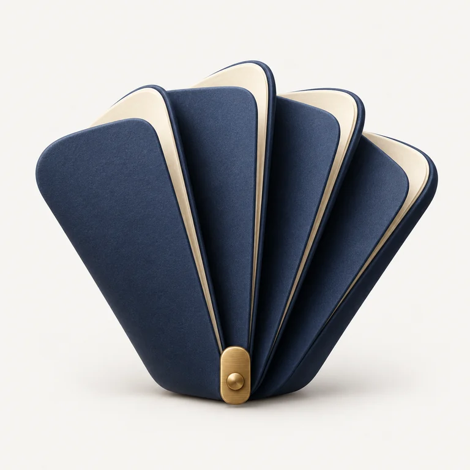
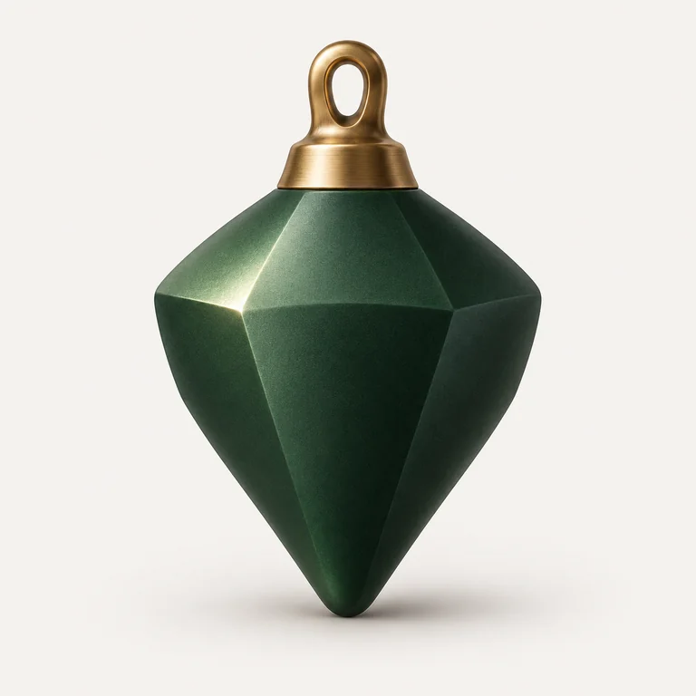
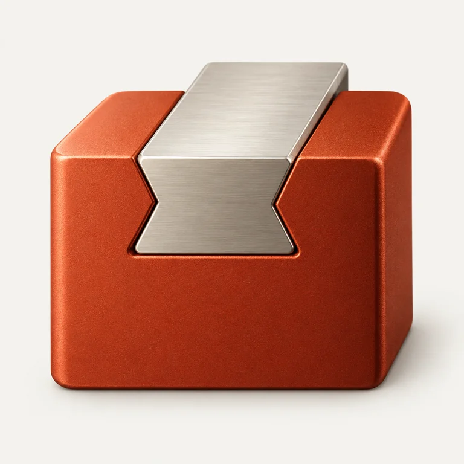
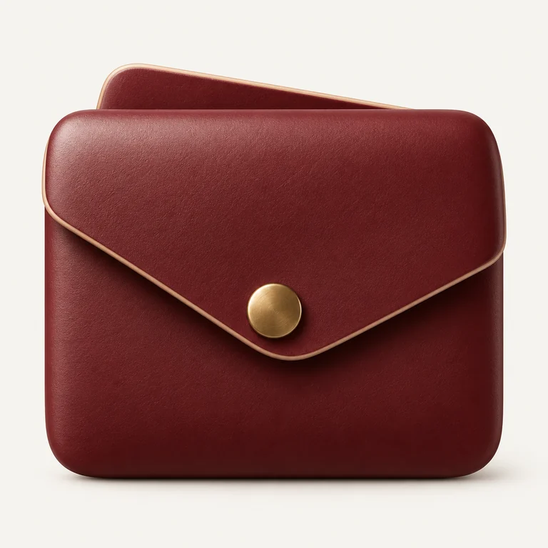
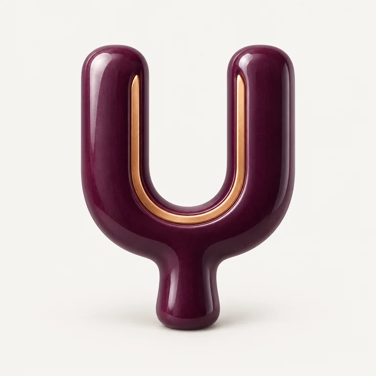
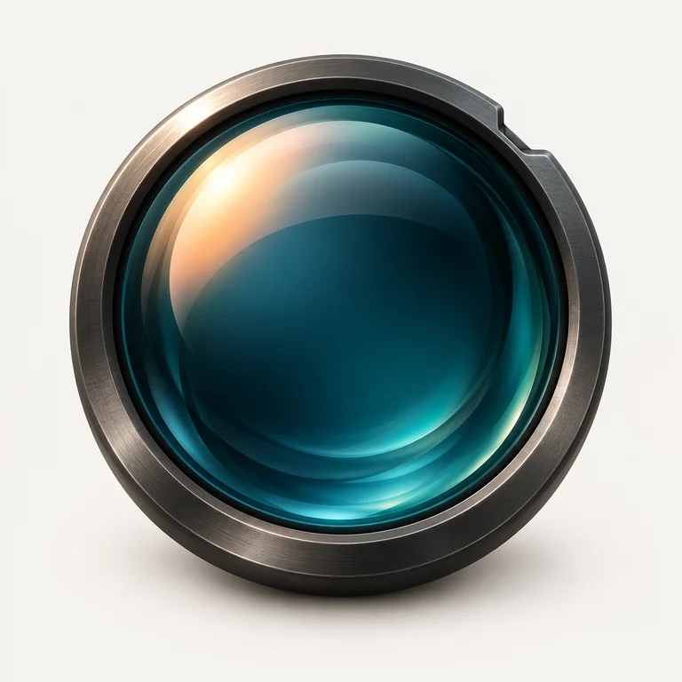

# Demo Icons

Six fictional product briefs, each carried from a one-line brief and concept to a complete English prompt and an actual raster render. The names, categories, and marks are illustrative only: they are not real customer brands, and no trademark clearance is implied. Select an image to open or download the full-size WebP; each prompt is complete and copyable as written.

## Pleatnote

<a href="../assets/demos/pleatnote.webp"></a>

**Brief:** A quiet notes app for linked thinking.

**Concept:** Connected pages become one compact accordion-folded paper folio with a lifted pleat and a small brass clasp, so the links read as one continuous object.

**Prompt:**

```text
Create one refined sculptural app icon for Pleatnote, a quiet notes app for linked thinking. Express connected pages as a compact accordion-folded paper folio, with one broad pleat lifted slightly. Five generous folds belong to one continuous object, forming a confident fan-shaped wedge with softly rounded corners; a small brass clasp holds the lower edge. The silhouette and broad folds must read at 32 px. Use deep ink-indigo matte paper with warm cream page edges, and brushed brass only on the clasp. Keep paper texture extremely subtle and the edges beautifully controlled. Light from the upper left with a large soft studio source, gentle self-shadow within the folds, restrained edge highlights, and a faint contact shadow. Square 1:1 composition, single centered icon occupying about 76% of the canvas, plain warm off-white #f5f3ef background, near-front view with subtle sculptural depth. No text, letters, numerals, watermarks, interface, mockup, decorative sparkles, or extra props. Render the actual isolated icon, not a presentation board.
```

## Stillpoint

<a href="../assets/demos/stillpoint.webp"></a>

**Brief:** A focus timer that makes deep work feel calm and grounded.

**Concept:** Attention settling into balance becomes one precision plumb bob with a compact suspension loop and no clock face.

**Prompt:**

```text
Create one refined sculptural app icon for Stillpoint, a focus timer that makes deep work feel calm and grounded. Represent attention settling into balance as one precision plumb bob, with a compact suspension loop and no clock face. Build a broad faceted teardrop body with six clean planes, a softened point, and one short integrated bronze cap and loop. The body is the clear hero; the cap and loop read as one support, with no dangling thin cord. Keep a strong stable silhouette recognizable at 32 px. Use deep pine-green satin enameled metal and one contrasting brushed-bronze accent on the cap. Reveal the facets through value and finish, not busy textures. Soft upper-left studio light, one restrained edge reflection, subtle ambient occlusion, and a faint grounding shadow. Square 1:1, single centered icon occupying about 76% of the canvas on plain warm off-white #f5f3ef. Near-front view, subtle depth. No text, numbers, letters, interface, mockup, extra props, glow, or watermark.
```

## Dovetail

<a href="../assets/demos/dovetail.webp"></a>

**Brief:** A developer toolkit built around reliable composition.

**Concept:** Compatible interfaces become two precision-machined blocks joined by one unmistakable dovetail joint.

**Prompt:**

```text
Create one refined sculptural app icon for Dovetail, a developer toolkit built around reliable composition. Express compatible interfaces as two precision-machined blocks joined by one unmistakable dovetail joint. A broad burnt-vermilion block holds a warm-silver trapezoidal insert, seated flush into its top face. The insert enters from one side; its wider head locks into the channel, producing a deliberate interlocking outline and one clearly visible seam. Use a compact architectural silhouette, generous planar faces, softly chamfered corners, and no intricate hardware. Vermilion fine-blasted anodized aluminum is the primary material, brushed warm silver aluminum the secondary. Light from the upper left with a large soft source; precise edge highlights and shallow contact occlusion explain the join. Square 1:1 image, one centered icon occupying about 76% of the canvas on plain warm off-white #f5f3ef. Near-front view with a slight elevated angle only to reveal the joint. No text, code, letters, symbols, UI, mockups, loose parts, extra props, or watermark.
```

## Cairn

<a href="../assets/demos/cairn.webp"></a>

**Brief:** A personal finance app for calmly allocating savings.

**Concept:** Organized money becomes one small folded envelope wallet with a broad overlapping flap and a single brass clasp, its inner pocket holding separate budgets together.

**Prompt:**

```text
Create one refined sculptural app icon for Cairn, a personal finance app for calmly allocating savings. Translate organized money into one small folded envelope wallet with a broad overlapping flap and a single brass clasp. The wallet has a soft rectangular silhouette with gently sloped upper corners; one offset inner pocket peeks above the back edge, showing separate budgets held together. Keep one hero wallet, one inner-pocket support, and one compact circular clasp. No banknotes or coins. Use oxblood matte leather with extremely restrained grain, cream cut edges, and brushed brass only for the clasp. No visible stitches or embossed branding. Give the flap believable thickness and a clean diagonal overlap. Large soft upper-left studio light, narrow contact shadow under the flap, gentle ambient occlusion, low satin highlights. Square 1:1 composition, centered icon occupying about 76% of the canvas on plain warm off-white #f5f3ef. Near-front view with subtle dimensionality. No letters, numerals, text, UI, mockup, extra props, or watermark.
```

## Timbre

<a href="../assets/demos/timbre.webp"></a>

**Brief:** An audio workspace for shaping sound precisely.

**Concept:** Resonance becomes one bold tuning fork with two broad rounded prongs and a short integrated stem, its U-shaped gap traced by a thin copper inlay.

**Prompt:**

```text
Create one refined sculptural app icon for Timbre, an audio workspace for shaping sound precisely. Represent resonance as one bold tuning fork with two broad rounded prongs and a short integrated stem. Keep the U-shaped opening wide and unmistakable, the prongs thick enough to read at 32 px, and the overall silhouette compact rather than tall and fragile. Gently taper the stem and soften every edge with a precise small radius. The hero is one continuous aubergine glazed ceramic form; a thin warm-copper inlay follows only the inside of the U, making the resonating gap visible. Use porcelain as the primary material and copper as the only secondary. Large soft upper-left light, a controlled broad highlight, soft interior occlusion, and a quiet contact shadow. Square 1:1, one centered icon occupying about 76% of the canvas on plain warm off-white #f5f3ef, near-front view with subtle depth. No waveform, music notes, text, letters, UI, mockups, extra props, or watermark.
```

## Coat

<a href="../assets/demos/coat.webp"></a>

**Brief:** A photographer's color-grading tool focused on light.

**Concept:** Controlled color becomes one thick optical lens in a narrow machined ring, its convex glass carrying a single warm coating reflection.

**Prompt:**

```text
Create one refined sculptural app icon for Coat, a photographer's color-grading tool focused on light. Represent controlled color as one thick optical lens in a narrow machined ring, with no camera body. The circular glass is gently convex with a broad readable surface, a soft beveled edge, and one small stepped notch in the outer ring. Its silhouette is solid and precise at 32 px; avoid intricate ridges or optical diagrams. Use deep petrol-cyan optical glass and brushed dark titanium, with one restrained warm-peach coating reflection across the glass. Show believable transparent depth while keeping the lens substantial; no rainbow flare or busy reflections. Large soft studio light from the upper left, a curved specular sweep, a clean dark inner rim, and a faint contact shadow. Square 1:1 image, single centered icon occupying about 76% of the canvas on plain warm off-white #f5f3ef. Near-front view with subtle depth. No text, letters, numerals, interface, mockup, extra props, or watermark.
```
